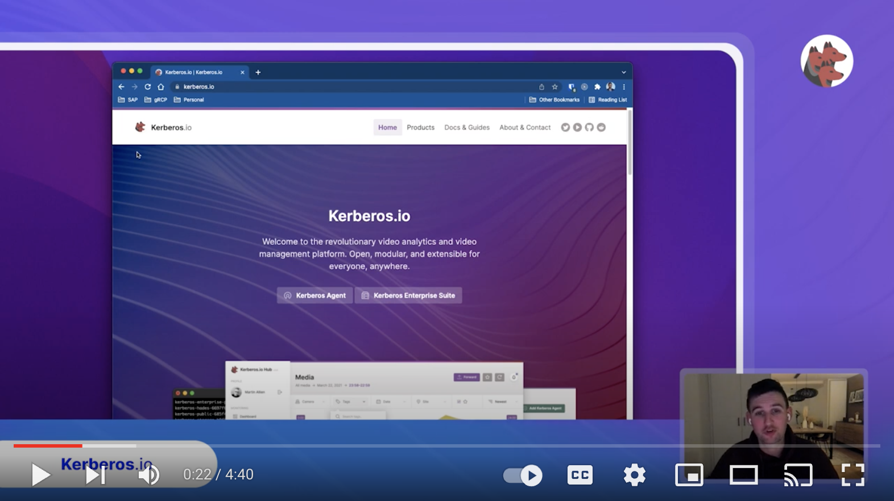

The Kerberos Agent is the recording service at the heart of every deployment. It runs next to, or on, a camera, processes that one camera stream, and records on motion or continuously. Each Agent has its own web interface for live view, recordings and settings, so a single Agent is a complete solution for one camera. It has been open source since the [Kerberos.io](/docs/prologue/) project started in 2014, and it is the foundation for everything from a home setup to deployments with thousands of cameras.

## What an Agent does

An Agent is deployed to the compute you choose, a VM, a bare-metal machine, a Raspberry Pi or a Kubernetes cluster, [in various ways](/docs/agent/installation), and connected to a camera stream you control. One Agent looks after one camera: add a camera, add an Agent. It applies motion-based or continuous recording and makes the recordings available through a user-friendly web interface.



## Why it is called Kerberos.io

Kerberos is also the name of a well-known [authentication protocol](<https://en.wikipedia.org/wiki/Kerberos_(protocol)>), which confuses people now and then. The name stays because of its suffix, **.io**: any **input**, a camera, and any **output**, such as a webhook, a script or an MQTT message. Kerberos keeps an eye on the input it is given and triggers the outputs you configure.

## Open and integrable

Many video management systems are closed: they offer no way to reach the data programmatically, which forces fragile, unsupported workarounds. The Agent takes the opposite approach.

> We want open and integrable systems for anyone and anywhere. You generate the data, you own the data.

The Agent exposes its configuration and data through APIs documented with Swagger, so you can automate it and build your own applications on top of it. You decide where it runs, in the cloud or self-hosted, and how: Docker, Docker Compose, Kubernetes, OpenShift, Terraform, Ansible and more.

## When you need more

There is no need to install anything else from the start: most deployments begin with a few Agents and grow. When you need more than one Agent can offer on its own:

- **Keep recordings in your own storage:** [connect the Agent to Vault](/docs/agent/connect-to-vault).
- **Watch every camera in one place:** [connect the Agent to Hub](/docs/agent/connect-to-hub).
- **Run an Agent for every camera on Kubernetes:** let [Factory](/docs/factory/) deploy and manage them.
- **See how the pieces fit together:** read [How it works](/docs/prologue/how/) and [Deployments](/docs/prologue/deployments/).

The [Agent GitHub repository](https://github.com/kerberos-io/agent) holds the most accurate and up-to-date information, including [the full list of features](https://github.com/kerberos-io/agent#a-world-of-kerberos-agents).
