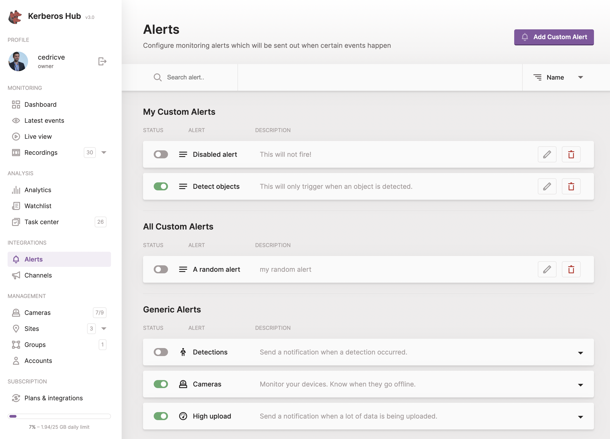

Once you have installed the Hub Helm chart and confirmed that all microservices are running properly, you should be able to access the Hub login screen and sign in through the default username and password [which was defined during the installation step](https://github.com/kerberos-io/hub#post-installation).



## Accounts

Once you have executed the post-installation steps, you should now have a user with the role **owner**. The owner role is the highest privileged role and gives access to all features, functions, Agents and related recordings of the specific user. An owner has an overview of all connected Agents, and can create sites, groups, alerts, channels, etc. The owner can also delegate specific Agents, sites or groups to sub accounts.

### Sub accounts

Sub accounts are created to delegate access to other users, and have a limited scope or access to the different Agents and their related recordings and livestreams.

An example of a sub account would be a site owner, a store owner, etc., who only needs access to the livestreams or cameras from the specific site or store.

On top of that a sub account can have a specific role such as **guest** or **editor**. This role will limit the access to specific functions and features.

You can create a new sub account by navigating to the accounts page and clicking on the `(+ Add Account)` button at the top left.



## Sites

While scaling and installing more and more Agents, it might become tedious to manage and structure them properly. For this reason, the concept of sites was created. A site is a logical grouping of a number of Agents that are physically installed at the same location.

By creating sites and assigning Agents to a specific site, it is easier to monitor specific video streams and their related recordings/events.

Next to that, sites also give an additional advantage in terms of authorisation and access control. As described in the accounts paragraph, a sub account can be granted access to only a limited number of sites, and therefore will only be able to view the Agents at a specific location.

You can create a new site by navigating to the sites page and clicking the `(+ Add Site)` button at the top left.



## Groups

Groups are similar to sites; the only difference is that a group is more abstract than a site. A group can be for example "Cash desks", "Entrance gates", "All stores of Belgium", "EMEA sites", etc. A group can be either a collection of sites, what we call then a **site group**, or it can contain a number of cameras from one or more sites, what we call a **group**.

Similar to sites, groups can also be used to give access to specific Agents, and introduce an extra level of flexibility and access control. As illustrated before you could have someone responsible for all "entrance gates" of all buildings within a specific country. By giving a sub account access to this group, he or she will only see the entrance gates of the different sites and not the other Agents belonging to the related sites.

You can create a new group by navigating to the groups page and clicking the `(+ Add Group)` button at the top left.



## Cameras

On the **Devices** page you will have an overview of all the cameras (Agents) your (sub) account has access to. This means that if your account only has access to a couple of sites or groups, the page will only show the Agents that belong to the related groups and sites.



The **Add Agent** button opens a dialog that writes the Agent's configuration for you. Enter an Agent name, select a site, paste the **Hub key** and **Hub private key**, then choose **Docker command** or **Kubernetes manifest** and select **Copy configuration**. The copied command has the Agent's Hub settings filled in.

### Assign an Agent

As explained in the modal, there are [different possibilities to set up and run an Agent](/docs/agent/installation).

Regardless of how you deployed an Agent, to connect the Agent to Hub you will require the account credentials from your Hub account to be shared with your Agents. By sharing those credentials you are linking your Agents to the relevant Hub account. [Connect to Hub](/docs/agent/connect-to-hub) shows where they go on the Agent; [Factory](/docs/factory/getting-started) sets them for every Agent it deploys.

Open **Plans & integrations** to find the **Public key** and **Private key** for your Agents. When [organisations and projects](/docs/hub/organisations#creating-and-managing-projects) are enabled, the credentials belong to the project instead: open **Project settings** and copy the **Agent public key** and **Agent private key**.

The Agent needs both keys, whether you use Hub SaaS or a self-hosted installation.



## Connect Vault

When your Agents store recordings in your own [Vault](/docs/vault), Hub needs to reach that Vault: each time someone opens a recording, Hub asks Vault for a signed URL. Give Hub the Vault API URL and the access key and secret key of a [Vault account](/docs/vault/accounts):

- **For your whole account**: open **Plans & integrations** and fill in **Vault settings**. The block is shown on Enterprise plans.
- **For one site**: open the site and fill in **Connect to dedicated Vault**, for example to use a Vault in the same region as that site's cameras. **Test connection** checks the URL and keys.
- **On a self-hosted installation**: set the `kerberosvault` values of the Helm chart (`uri`, `provider`, `accesskey` and `secretkey`).

These settings only let Hub read recordings. For new recordings to show up in Hub, Vault also needs its [Hub integration](/docs/vault/integrations#kerberos-hub).

## Integrations

You have your accounts set up, sites and groups created and, last but not least, one or more Agents connected to your Hub.

Now it is time to configure some integrations using alerts and channels. The idea of integrations is that you can send messages to other 3rd-party services, or your own APIs, when an interesting event/alert occurs.



### Alerts

Alerts can be configured to trigger one or more channels on specific events. Generic or custom alerts can be configured to meet specific requirements and behaviours. A more in-depth configuration of both generic and custom alerts is explained below.



#### Generic Alerts

Generic alerts (legacy) are the first alerts created in Hub. Three different alerts can be configured:


- **Detections**: send a notification if a recording was received from a specific Agent, within a time range, with a specific classification, etc.
- **Devices**: when one of your Agents stops working, a notification will be sent.
- **High upload**: when a lot of recordings are generated within a specific period of time, a notification can be sent.

#### Custom Alerts

To be written

### Channels

Multiple channels can be configured and used as an event endpoint. Each channel has its own API and visualisation to the end user, so we will discuss them below.

#### Webhook

By configuring a webhook, you will be able to receive the event/notification through an HTTP (POST) call. The notification will contain basic information and the actual video recordings. An example of the event looks like this.

    "body": {
        "id": "c704244e6js97h3ob9k0",
        "type": "detection",
        "timestamp": 1639989520,
        "title": "Hey martin something happend at your ingarage.",
        "body": "A pedestrian was detected at 09:38.",
        "unread": true,
        "user": "martin",
        "userid": "57e1011e3178aa6c5cc774d6",
        "sequenceid": "61c040e27dc0c8cf9fb851a2",
        "media": [
            {
                "timestamp": 1639989500,
                "type": "video",
                "url": "https://storage.googleapis.com/kstorage-europe-west1/martin/1639989500_6-967003_ingarage_200-200-400-400_24_769.mp4?Expires=1640162320&GoogleAccessId=xxx"
            }
        ]
    }

To easily verify whether the POST request is happening, you can use a public webhook service like `https://pipedream.com/`. By creating an account, you will receive your own HTTP endpoint and all the required inspection tools.



## Media proxy

By default Hub hands the URLs it receives from Vault straight to the browser. Depending on the Vault configuration these point to Vault ([vault-signed URLs](/docs/vault/providers#url-signing)) or directly to the storage provider (S3, MinIO, GCS, Azure presigned URLs).

Enable the media proxy to hide both. The Hub API then asks Vault for the signed URL as usual, seals it into an opaque, encrypted token and returns a Hub API URL instead:

```
https://api.yourdomain.com/media/proxy?t=<token>
```

When the browser requests that URL, the Hub API decrypts the token and streams the recording, thumbnail or sprite from Vault/storage. Range requests (seeking, HLS byte ranges) are supported, and upstream error bodies and identifying headers are never forwarded. Backend workers (workflows, redaction, analysis) keep fetching directly from Vault.

Configure it through the Helm chart (`kerberoshub.api.mediaProxy`) or these hub-api environment variables:

| Variable | Description | Default |
| --- | --- | --- |
| `MEDIA_PROXY_ENABLED` | `true` to return Hub API proxy URLs instead of Vault/storage URLs. | `false` |
| `MEDIA_PROXY_PUBLIC_URL` | Public base URL of the Hub API used in proxy URLs. | `API_URL` |
| `MEDIA_PROXY_KEY` | Key used to encrypt the tokens (`openssl rand -hex 32`). Must be identical on all hub-api replicas. | derived from `KERBEROS_JWT_SECRET` |
| `MEDIA_PROXY_TTL` | Lifetime of a proxy URL (Go duration, max `168h`). | `24h` |

All media bytes now flow through the Hub API, so size its replicas, ingress timeouts and bandwidth accordingly. The token only grants access to that single object until it expires, exactly like a signed URL.

## What's next

Want to learn more about how Hub works under the hood? Then [have a look at the Hub pipeline page](/docs/hub/pipeline) where we introduce the microservice architecture.
