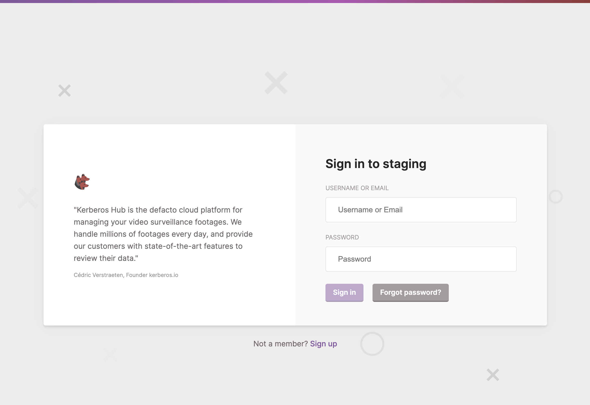
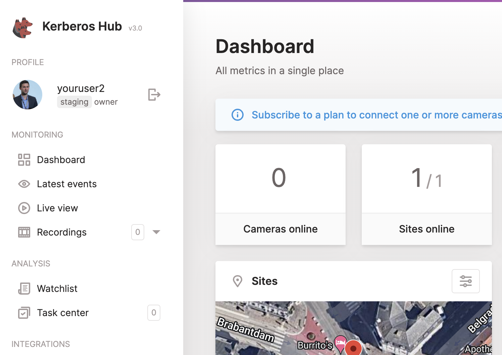

By default the Hub project can be used in a multi-tenancy mode. By creating multiple user and related (sub) accounts you can provide multiple users/customers/companies access to the (same) central platform. Each master user will have a set of sites, groups and cameras attached which can be further delegated to (sub) accounts. This means that sites in a geography can be managed by a specific user working in that specific timezone, etc.

By using domains you can bring multi-tenancy to another level. A domain adds another abstraction layer on top of the default user account. It creates a context in which usernames and users are unique; in other words, the same username can be used in multiple domains.

## Introduction

The domain feature works through the concept of a subdomain. By prefixing the `tenantBaseDomain` with a subdomain you indicate to Hub which domain the user belongs to. When opening the login page, the page will show the name of the domain you are trying to sign in to.

Once logged in, you will see the domain badge next to your username in the profile section (top left). This indicates which domain the user is currently signed in to.

Any (sub) accounts you will create from the master account will automatically be added to the same domain, and be linked to the master account.

## Configuration

To enable the domain feature, you will need to set two environment variables in the Hub frontend container. By opening the `values.yaml` of your Helm chart, you can change the following properties.

    # By default the Hub allows multi-tenancy through the concept
    # of accounts and subaccounts. However through the concept of domains, you
    # take it a step further. Within a domain, user accounts are unique, and are prefixed by a (domain\).
    multiTenant: true
    tenantBaseDomain: "yourdomain.com" 

By setting `multiTenant` to true you indicate to Hub that you want to enable the domain feature. Once enabled you can provide the `tenantBaseDomain`, which you use as a basis for your domains as DNS sub domains. 

When configured and deployed you can start using sub domains to differentiate the domains in Hub. For example, if `hub.kerberos.live` is used as the `tenantBaseDomain`, the following subdomains will result in the equivalent Hub domain.

  - `customera.hub.kerberos.live` -> `customera` domain
  - `customerb.hub.kerberos.live` -> `customerb` domain
  - `xyz.hub.kerberos.live` -> `xyz` domain
  - `develop.hub.kerberos.live` -> `develop` domain

Once hitting a specific domain and, for example, creating a user, the user itself will be stored as a master user in the Hub database, but will be prefixed with a `domain@` in the username. When hitting the login page users will be able to sign in with their regular username, but internally the user will be authenticated with the `domain@` prefix.
