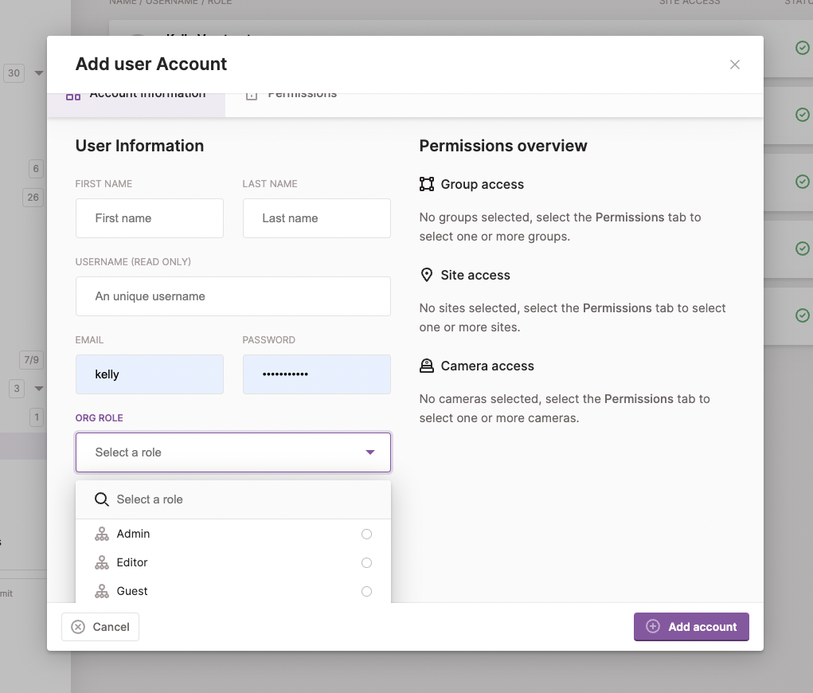
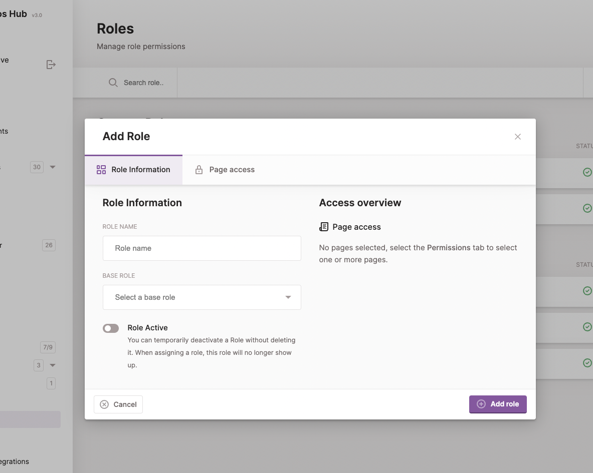
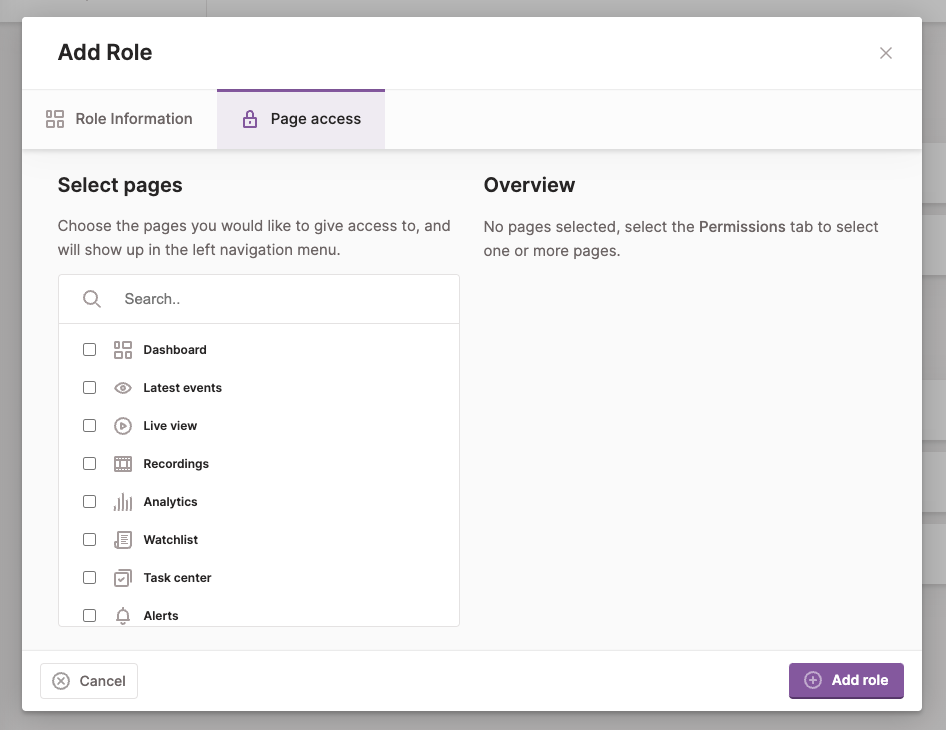

Every Hub user has a role. The role decides **what** a user can do: watch live video, edit sites, manage members, and so on. Which cameras the user sees is decided separately, by the sites, groups and cameras assigned to them. A user with a broad role still only sees the cameras they are given.

This page has two parts:

1. [The roles you use today](#roles-today): Owner, Admin, Editor, Guest and custom roles.
2. [The new permission model](#the-new-permission-model): named permissions such as `members.read` or `live.stream`, bundled into organisation and project roles.

Existing users keep exactly the access they have today when Hub moves to the new model. See [Moving to the new model](#moving-to-the-new-model).

## Roles today

The user who creates a Hub account is its **Owner**. An owner can create additional users, give each of them a role (`admin`, `editor` or `guest`), and decide which sites, groups and cameras each of them can access.

### What each role can do

✓ means the role can do it. Everything happens within the cameras assigned to the user.

#### Cameras and live video

| Action | Guest | Editor | Admin | Owner |
| --- | :-: | :-: | :-: | :-: |
| See cameras and watch live video | ✓ | ✓ | ✓ | ✓ |
| Trigger camera inputs and outputs (IO) | ✓ | ✓ | ✓ | ✓ |
| Control PTZ cameras and use presets | | ✓ | ✓ | ✓ |
| Change the camera's configuration | | ✓ | ✓ | ✓ |
| Edit a camera's settings in Hub | | | ✓ | ✓ |
| Delete cameras, set per-camera limits, change the recording mode, read camera logs | | | | ✓ |

#### Sites, groups, floor plans and videowalls

| Action | Guest | Editor | Admin | Owner |
| --- | :-: | :-: | :-: | :-: |
| See sites, groups, floor plans and IO | ✓ | ✓ | ✓ | ✓ |
| Create, edit and delete floor plans | | ✓ | ✓ | ✓ |
| Create sites and groups | | | ✓ | ✓ |
| Edit sites | | | ✓ | ✓ |
| Edit and delete groups, delete sites | | | own | ✓ |
| Delete IO | | | ✓ | ✓ |
| See videowalls assigned to them | ✓ | ✓ | ✓ | ✓ |
| Create videowalls, edit and delete their own | | ✓ | ✓ | ✓ |
| See, edit and delete every videowall, assign users to walls | | | ✓ | ✓ |

*own*: only the ones the admin created.

#### Recordings, cases and alerts

| Action | Guest | Editor | Admin | Owner |
| --- | :-: | :-: | :-: | :-: |
| Watch, download, redact and share recordings | ✓ | ✓ | ✓ | ✓ |
| Use analytics and markers | ✓ | ✓ | ✓ | ✓ |
| Use the Watchlist (notifications) | ✓ | ✓ | ✓ | ✓ |
| Create, update, share and export cases, run workflows on them | ✓ | ✓ | ✓ | ✓ |
| Change who is on a case, delete cases | | | ✓ | ✓ |
| Create and edit alerts | | | ✓ | ✓ |
| Delete alerts | | | own | ✓ |
| Manage labels | | | ✓ | ✓ |
| Create and edit workflows | | | | ✓ |
| Manage channels and notification settings | | | | ✓ |

A few rules apply to every role, owners included:

- **Private cases** are visible only to their reporter, assignee and participants. The reporter can always change the case's members.
- **Private alerts** are visible only to the user who created them.
- **What you create is yours.** Creators keep editing and deleting their own videowalls and alerts.

#### Organisation and settings

| Action | Guest | Editor | Admin | Owner |
| --- | :-: | :-: | :-: | :-: |
| Edit organisation and project settings, project credentials | | | ✓ | ✓ |
| Invite, edit and remove users, decide which cameras they access | | | ✓ | ✓ |
| Create and edit custom roles | | | ✓ | ✓ |
| Delete custom roles | | | | ✓ |
| Create and delete projects | | | ✓ | ✓ |
| Manage users who are owners, grant the Owner role | | | | ✓ |
| Billing, subscription and storage (Vault) | | | | ✓ |
| Audit log, access tokens, device system tags | | | | ✓ |

### Custom roles

The built-in roles cannot be changed. For finer control, create a **custom role**. A custom role starts from one of the built-in tiers (guest, editor or admin) and then:

- **hides pages**: a page that is not in the role's page list is not shown, and the actions that only that page offers are not available either;
- **limits features**: for PTZ, live view, remote configuration and downloading recordings, you choose a level such as *no live view*, *preview only* or *zoom only*.

Owners can also set **per-camera limits**. A camera's limits apply on top of the user's role: a user who may control PTZ cannot move a camera that only allows presets.

## The new permission model

Hub is moving from the fixed tiers above to **permissions** that are bundled into **roles** and granted with **role assignments**. This is part of the move to [organisations and projects](/docs/hub/organisations).

- A **permission** is one thing a user can do, named `<area>.<action>`: `members.read`, `live.stream`, `cases.delete`.
- A **role** is a named set of permissions. Hub ships ready-made roles; organisations can define their own.
- A **role assignment** gives a role to a member **somewhere**: the whole organisation, or one project, optionally limited to selected sites, groups and cameras, and optionally to a time window such as a night shift.

The role says *what*, the assignment says *where*. A member can hold several assignments, for example Editor on one site and Viewer on another; they add up.

### Organisation and project permissions

Every permission belongs to one of two levels, and a role only holds permissions of its own level:

| Level | Covers | Examples |
| --- | --- | --- |
| Organisation | Running the organisation: members, roles, projects, billing | `members.invite`, `roles.update`, `billing.manage` |
| Project | Working with cameras and footage inside a project | `devices.read`, `live.stream`, `media.export`, `cases.create` |

Organisation roles grant nothing inside a project. An Organisation manager can add people to a project without seeing that project's cameras.

### Built-in roles

| Role | Level | Can | Cannot |
| --- | --- | --- | --- |
| **Owner** | Organisation, all projects | Everything, in every project, including permissions added later. | — |
| **Organisation manager** | Organisation | Manage members, roles and organisation settings; give people access in every project. | See project cameras or recordings; billing, storage, audit log. |
| **Billing admin** | Organisation | View and manage the subscription and invoices. | Anything else. |
| **Project admin** | Project | Everything in the project: device configuration, recording mode, workflows, channels, project settings and who has access. | Organisation settings, billing. |
| **Editor** | Project | Watch and control cameras (PTZ, IO), work with recordings and cases, export and share, create and update sites, groups, floor plans, videowalls, labels and alerts. | Delete (except what they created), configure devices, change project settings or access. |
| **Viewer** | Project | Watch live and recorded video and see everything in scope. | Change anything, move PTZ cameras, export or share. |

Viewer ⊂ Editor ⊂ Project admin: each project role includes everything of the one before it.

Several members can be Owner, and an organisation always keeps at least one. Only owners grant or revoke Owner, and never to themselves.

#### Owner-only permissions

Some permissions are so sensitive that **only owners can grant them**: billing, storage, deleting cameras, per-camera limits, recording mode, camera logs, device system tags, workflow authoring and channels. A role that contains one of them, such as Project admin or Billing admin, can only be created, changed or assigned by an owner. This way an Organisation manager can hand out at most what an Admin can do today.

### Permission catalog

Organisation permissions:

| Area | Permissions |
| --- | --- |
| Organisation | `organisation.read`, `organisation.update` |
| Members | `members.read`, `members.invite`, `members.update`, `members.remove` |
| Roles | `roles.read`, `roles.create`, `roles.update`, `roles.delete` |
| Teams *(planned)* | `teams.read`, `teams.create`, `teams.update`, `teams.delete` |
| Projects | `projects.create`, `projects.delete`, `projects.manageAccess` |
| Billing † | `billing.read`, `billing.manage` |
| Storage † | `storage.read`, `storage.update` |
| Audit | `audit.read` |
| Devices † | `devices.manageSystemTags` |

Project permissions:

| Area | Permissions |
| --- | --- |
| Devices | `devices.read`, `devices.update`, `devices.configure`, `devices.delete` †, `devices.managePermissions` †, `devices.manageRecording` †, `devices.readLogs` † |
| Live video | `live.preview`, `live.stream` |
| PTZ | `ptz.zoom`, `ptz.panTilt`, `ptz.control`, `ptz.presets` |
| IO | `io.read`, `io.create`, `io.delete`, `io.trigger` |
| Sites, groups, floor plans | `sites.*`, `groups.*`, `floor-plans.*`: `read`, `create`, `update`, `delete` |
| Videowalls | `videowalls.read`, `videowalls.create`, `videowalls.update`, `videowalls.delete`, `videowalls.assign` |
| Recordings | `media.read`, `media.update`, `media.export`, `media.share`, `media.redact`, `media.delete`, `media.forward`, `days.read` |
| Markers and analytics | `markers.read`, `markers.write`, `analytics.read`, `detections.read`, `detections.create`, `detections.delete` |
| Cases | `cases.read`, `cases.create`, `cases.update`, `cases.share`, `cases.export`, `cases.runWorkflow`, `cases.delete`, `cases.manageMembership`, `cases.moderateComments` |
| Workflows | `workflows.read`, `workflows.create` †, `workflows.update` †, `workflows.delete` †, `workflow-runs.read`, `workflow-runs.create` |
| Alerts and notifications | `alerts.read`, `alerts.create`, `alerts.update`, `alerts.delete`, `alerts.managePrivacy`, `notifications.read`, `notifications.update` |
| Channels † | `channels.read`, `channels.create`, `channels.update`, `channels.delete` |
| Labels | `labels.read`, `labels.create`, `labels.update`, `labels.delete` |
| Project | `project.update`, `project.manageCredentials`, `project.manageAccess` |

† owner-only: only owners can grant a role that contains it.

Two more details:

- **Graded permissions.** Higher grades include lower ones: `live.stream` includes `live.preview`; `ptz.presets` includes `ptz.control`, which includes `ptz.zoom` and `ptz.panTilt`. These replace the numeric feature levels of custom roles.
- **Page permissions.** Permissions ending in `.page`, such as `cases.page` or `members.page`, decide which pages appear in the navigation. They replace the page list of custom roles.

## Moving to the new model

When your organisation moves to the new model, nobody gains or loses access:

- Owners get the **Owner** role.
- Admins, editors and guests get a **legacy role** (*Admin (legacy)*, *Editor (legacy)*, *Guest (legacy)*) that reproduces exactly what they can do today, as described in [What each role can do](#what-each-role-can-do).
- Custom roles become legacy roles with the same pages and feature levels, expressed as permissions.
- The sites, groups and cameras each user can access move to their role assignment.

You can then replace legacy roles with the built-in roles, or with your own, at your own pace. For the data model behind roles and assignments, see [Organisations and projects](/docs/hub/organisations#role-levels-and-permissions).
