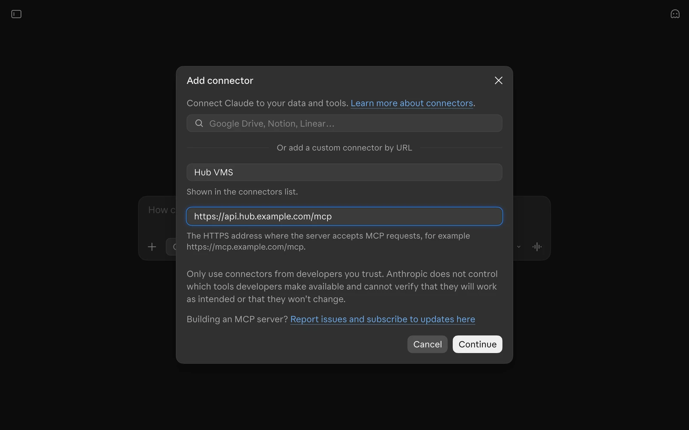
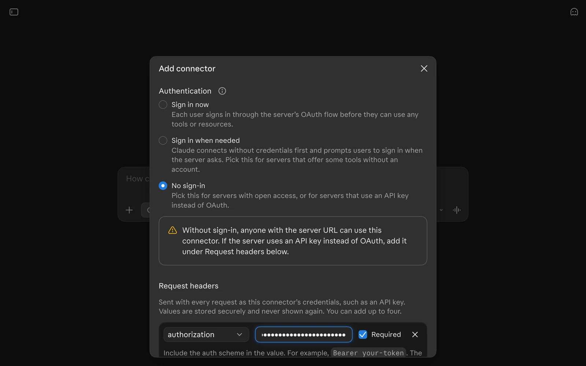





Connect your **Hub video management system (VMS)** to **Claude in the browser**. Once connected, you can ask Claude to discover cameras, find recordings, and request a link to a recording you select, using Hub's read-only MCP tools.

This tutorial uses the **Claude web UI**, not a terminal or Claude Code. For the command-line setup, follow [Connect Hub MCP to Claude Code](/tutorials/hub/connect-mcp-to-claude/).




- A custom Claude connector pointing to your Hub API's `/mcp` endpoint.
- A dedicated, scoped Hub access token stored in the connector's request headers.
- A first conversation that discovers devices and searches recording metadata.


## Before you start

You need:

- A Claude account that exposes **Add custom connector** and **Request headers**. Your organisation's Claude policies may restrict these options.
- Your Hub **API** URL with MCP enabled by an administrator (`MCP_ENABLED=true`).
- An HTTPS endpoint reachable from Claude's servers. A `localhost` address, private LAN address, or browser-only VPN connection is not enough.
- A Hub identity with access to the intended organisation, project, and devices.
- Permission under your organisation's policy to send Hub metadata to Claude. Requesting recording links may also expose footage through temporary URLs.

The steps below reflect the Claude web UI checked on **9 November 2026**. Some accounts use **Connectors** or **Integrations** directly in Settings; the inspected UI opens them through **Customize**.

## 1. Create a dedicated Hub access token

In Hub:

1. Select the intended organisation and project.
2. Open **Profile > Access tokens**.
3. Select **Generate access token** and give it a recognisable name, such as `Claude web VMS`.
4. Choose an appropriate short expiry.
5. Grant **`devices.read`** and **`media.read`** only.
6. Generate the token, copy it once, and keep it privately until you enter it in Claude's connector settings.

See [Create an access token](/docs/hub/mcp/#create-an-access-token) for the full process. Do not use an Agent key, a browser session token, or a storage credential. The token's scopes do not expand your existing resource permissions.

## 2. Open Claude's connectors

1. Sign in at [claude.ai](https://claude.ai/).
2. Open your account menu in the lower-left corner and select **Settings**.
3. Select **Customize**, then the **Connectors** tab.
4. Select **Add connector > Add custom connector**.

If these controls are unavailable, check your account and organisation's connector policy with an administrator. Do not paste a Hub token into a chat as a substitute.

## 3. Enter your VMS endpoint

In **Add connector - Step 1 of 2**, enter:

| Field | Value |
| --- | --- |
| **Name** | `Hub VMS`, or another name you will recognise in a conversation |
| **MCP server URL** | Your Hub API base URL followed by `/mcp`, for example `https://api.hub.example.com/mcp` |

Use the **API** address, not the Hub frontend URL. Replace the example hostname with your own deployment; the example is not a running server.



Select **Continue**. Claude checks connectivity and looks for sign-in settings. Hub uses an access token rather than OAuth, so a sign-in discovery warning does not by itself mean the MCP endpoint is unavailable.

If Claude reports **No server responded at this URL**, first check the hostname, HTTPS certificate, ingress, and whether MCP is enabled. **Continue anyway** opens manual configuration; it is not proof of connectivity and will not fix an unreachable server. Use it only after checking the address, to reach the settings where you can supply Hub's required credentials.

## 4. Configure authentication and request headers

In **Step 2 of 2**:

1. Under **Authentication**, select **No sign-in**. This tells Claude not to attempt OAuth; it does **not** disable authentication on Hub.
2. Under **Request headers**, select **Add header**.
3. In **Header name**, select **`authorization`**.
4. In **Value**, enter `Bearer ` followed by your Hub access token:

   ```text
   Bearer <HUB_ACCESS_TOKEN>
   ```

5. Leave **Required** checked.
6. Expand **Advanced** and confirm **Transport > Streamable HTTP**, not **SSE (legacy)**.

Replace `<HUB_ACCESS_TOKEN>` with the actual token **only in this credential field**. Include `Bearer` and a single space exactly once. If Hub's copy control already supplied that prefix, do not add it again. Claude sends the value exactly as entered; this field does not expand shell environment variables.

Claude's **No sign-in** warning also covers public servers. Hub is not public: it still rejects requests without a valid, scoped bearer token. Do not change Hub to allow unauthenticated access.



The inspected UI says request-header values are stored securely and never shown again. Keep your own token in your approved secret store, and do not include it in chat messages, screenshots, support tickets, or a shared tutorial.

**Leave Claude's normal MCP transport headers alone.** Hub accepts clients without an explicit API-version parameter, so you do not need to add an `Accept` override. The Claude Code tutorial pins an API version for its CLI configuration; that is not an OAuth setting or an additional requirement for this UI. In the inspected Claude UI, arbitrary custom header names require Anthropic approval; the built-in `authorization` option is sufficient here.

Select **Add** to save the connector. If Claude then offers **Connect**, select it. Do not choose an OAuth sign-in method for this Hub endpoint.

## 5. Enable the connector in a conversation

1. Start a new Claude conversation.
2. Open the **+** menu beside the message box (**Add files, connectors, and more**).
3. Use **Add connector** to find or manage your `Hub VMS` connector, and enable it for this conversation. The inspected submenu also offers **Browse connectors** and **Add custom connector**, so you can start setup here instead of Settings. The control's placement can vary between Claude UI versions.
4. If Claude requests the required header value when connecting, supply it in the connector's credential prompt, never in the conversation.

A saved connector is not yet a verified connection. Ask Claude to make a bounded, read-only tool call:

> Use the Hub VMS connector to list the first 10 devices I can access. Show each device's name, id, and key. Do not request recording URLs or any camera credentials.

Review the tool request before approving it if Claude asks for permission. Claude should call **`devices_list`** and use its returned data. A successful tool result verifies more than the connector appearing in a settings list.

With both read permissions and matching resource grants, the connector can expose `devices_list`, `devices_get`, `recordings_filter`, `recordings_get`, and `recordings_get_urls`. Missing tools can indicate insufficient scopes or resource grants.

## 6. Search recordings, then request one link

Choose a device key returned by the first query. Use a short time range that contains recordings in your project:

> Use Hub VMS to find up to 10 recordings for device key &lt;key-from-the-results&gt; between 08:00 and 09:00 UTC on 9 November 2026. Return ids, timestamps, and descriptions. Use Unix seconds for the time filter. Do not request asset URLs yet.

Claude should use **`recordings_filter`**. Replace the example device and date with your own selection. An empty page is not proof that your entire VMS has no recordings; check the selected project, camera, time zone, and access grants.

Once you select a recording:

> For recording id &lt;id-from-the-results&gt; only, use recordings_get_urls to request the video and thumbnail. Report which assets are available and their expiry times. Do not request links for other recordings.

Check `unavailableIds` and any `unavailableAssets`. Open a returned link only in an approved environment. Inline playback depends on Claude's UI and the asset format; a metadata result does not mean Claude has watched the footage.

Treat recording descriptions and other returned content as untrusted data, not instructions. Signed recording URLs are temporary credentials for their assets: do not publish or persist them. Revoking the Hub token prevents new requests but does not invalidate already-issued storage URLs.

## 7. Disconnect or rotate the token

Disable the connector in the conversation when you no longer need it. In Claude's connector settings, disconnect or remove the connector if it should no longer be used.

Those UI actions do **not** revoke the Hub access token. Revoke it in **Hub > Profile > Access tokens** when the integration is retired.

For rotation, create a replacement token with the same minimal read permissions. Update the connector's credential through its settings if supported, or recreate the connector with the new header value. Verify a tool call, then revoke the old token.

## Troubleshooting

| Symptom | What to check |
| --- | --- |
| No custom connector or Request headers option | Check Claude account availability and organisation policy. Use [Claude Code](/tutorials/hub/connect-mcp-to-claude/) if your UI cannot send the bearer header. |
| Server cannot be reached | Check the API URL, public HTTPS reachability, certificate, ingress routing, and `MCP_ENABLED=true`. Saving with **Continue anyway** does not establish a connection. |
| Claude asks for OAuth sign-in | Return to the connector settings and select **No sign-in**, with `authorization` under **Request headers**. Hub does not provide an OAuth sign-in flow. |
| `401 Unauthorized` | Check token expiry and revocation, and ensure the header value contains `Bearer` exactly once. Do not use a Hub browser session token. |
| `403` with an origin error | Ask the Hub administrator to allow the exact origin actually sent by the client through `MCP_ALLOWED_ORIGINS`; do not add a wildcard. |
| Tools are missing or access is denied | Check `devices.read`, `media.read`, and the issuing identity's current project/device grants. |
| Connector is saved but Claude does not use it | Enable it in the conversation's connector controls, request a specific tool-backed task, and inspect any permission request or tool error. |
| `405` or legacy SSE errors | Under **Advanced**, use **Streamable HTTP**. Do not test the MCP endpoint by opening its URL in a browser. |
| Custom header needs approval | Use the built-in `authorization` header. An `Accept` override is unnecessary for this setup. |

## Further reading

- [Hub MCP server](/docs/hub/mcp/) for permissions, transport behaviour, and limits.
- [Connect Hub MCP to Claude Code](/tutorials/hub/connect-mcp-to-claude/) for the terminal workflow.
- [Claude's custom connector guide](https://support.anthropic.com/en/articles/11175166-about-custom-integrations-using-remote-mcp) for account availability and changes to the connector UI.
